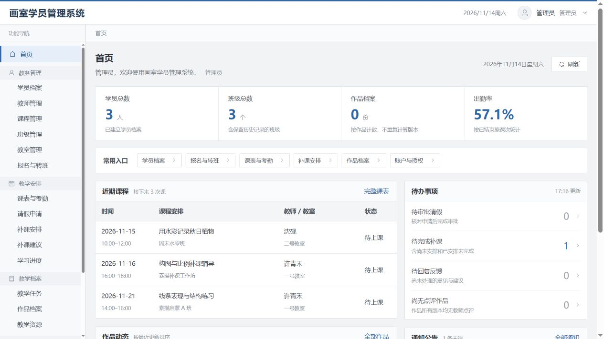

# 画室学员管理系统 · Art Studio Management

面向小型画室的教务管理系统，包含管理员、教师、学员及监护人只读授权。后端采用 Java 单体应用，前端使用 Vue，支持本地文件存储和阿里云 OSS 私有存储。



## 功能

- 独立首页：统计、近期课程、待办事项、通知与学习进度，按账号权限聚合。
- 教务：学员、教师、课程、班级、教室、报名与转班、账户管理。
- 教学：排课与冲突校验、考勤与更正、请假审批、补课安排和学习进度。
- 档案：教学任务、作品多版本提交与点评、教学资源、个人头像。
- 沟通：通知、反馈与回复、操作记录。
- 权限：JWT 登录、BCrypt 密码、账号会话失效、教师/学员数据范围与监护人只读权限。

## 技术栈

| 部分 | 技术 |
| --- | --- |
| 后端 | Java 17、Spring Boot 3.5.7、Spring MVC、MyBatis |
| 数据库 | MySQL 8，事务、外键、唯一约束 |
| 前端 | Vue 3、Vue Router、Element Plus、Axios、Vite 6 |
| 存储 | 默认本地私有存储，可选阿里云 OSS SDK |
| 登录 | JWT、BCrypt，可选 Redis 登录限流 |

本地运行不需要 OSS、Redis 或服务器账号。未启用 Redis 时使用进程内登录限流。

## 本地运行（Windows）

准备 JDK 17、Maven 3.6.3+、Node.js 22、npm、MySQL 8，并把 Maven、Node 加入 PATH，设置 JAVA_HOME 指向 JDK 17。脚本支持 Windows PowerShell 5.1 和 PowerShell 7。

1. 启动自己的 MySQL，以有建库权限的账号执行以下 SQL。将示例密码替换为自己的本地数据库密码；不要导入服务器备份。

```sql
CREATE DATABASE studio CHARACTER SET utf8mb4 COLLATE utf8mb4_unicode_ci;
CREATE USER 'studio'@'127.0.0.1' IDENTIFIED BY 'CHANGE_ME_LOCAL_DATABASE_PASSWORD';
GRANT SELECT, INSERT, UPDATE, DELETE, CREATE, ALTER, INDEX, REFERENCES
ON studio.* TO 'studio'@'127.0.0.1';
```

2. 在项目根目录执行以下命令，并修改 `.env.local` 中的数据库账号、密码和连接地址：

```powershell
Copy-Item .env.example .env.local
notepad .env.local
```

3. 构建并启动：

```powershell
.\scripts\start-dev.ps1
```

访问 <http://127.0.0.1:5173>。首次启动在独立的 `studio` 数据库自动建表并生成虚构演示数据；已有记录不会被脚本清空。默认端口为前端 5173、后端 18080，可在配置中调整后端端口。日志位于忽略提交的 `work/`。

```powershell
# 已构建且依赖已安装时
.\scripts\start-dev.ps1 -SkipBuild
# 仅停止该副本启动的前后端，不停止 MySQL
.\scripts\stop-dev.ps1
```

PowerShell 若阻止本地脚本，可仅在当前终端执行 `Set-ExecutionPolicy -Scope Process Bypass` 后重试。

### 本地演示账号

| 身份 | 账号 | 密码 |
| --- | --- | --- |
| 管理员 | admin | admin |
| 测试学员 | test | test |
| 素描教师 / 水彩教师 | teacher / teacher2 | Studio@2026 |
| 学员 | student / student2 | Studio@2026 |
| 监护人，只读绑定学员业务 | guardian | Studio@2026 |

上述弱密码只用于本机 dev 演示。prod 模式不创建演示账号，首次创建管理员要求独立的强密码。示例中的姓名和教学记录为虚构；示例手机号只作为占位值使用，不要实际拨打。

### macOS / Linux

按上面的步骤准备数据库，在终端中设置 `.env.example` 对应的环境变量（该文件不会被 Spring 自动读取）。至少设置 STUDIO_DB_URL、STUDIO_DB_USERNAME、STUDIO_DB_PASSWORD、SPRING_PROFILES_ACTIVE=dev、SERVER_ADDRESS=127.0.0.1。分别启动两个终端：

```bash
# 终端一：导出环境变量后，在项目根目录构建和运行后端
mvn -f backend/pom.xml clean package
cd backend
java -Duser.timezone=Asia/Shanghai -jar target/studio-1.0.0.jar
```

```bash
# 终端二
cd frontend
npm ci
npm run dev
```

## 存储与部署

- 默认文件位于 `backend/uploads`；目录和数据库共同保存文件关联，不能只备份其中之一。
- OSS 接入、私有对象权限和文件目录规范见 [OSS 配置](docs/OSS配置.md)。不提供任何作者的云资源或访问凭据。
- 生产构建默认部署在 `/art-studio/`；开发服务默认使用 `/`。如需其他目录，通过 STUDIO_BASE_PATH 覆盖并同步 Nginx 路由。
- Linux 部署步骤和配置模板见 [部署说明](docs/部署说明.md)。

## 代码与测试

```text
backend/src/main/java/com/shise/studio/
  auth/              登录、密码与会话
  catalog/           基础档案与账户
  business/          报名、排课、请假补课、作品与统计
  communication/     通知与反馈
  files/             文件、头像与存储权限
frontend/src/        页面、路由、通用表格与样式
database/            建表脚本与已有库的增量迁移
deploy/              通用生产配置模板
scripts/             Windows 启停与隔离 API 回归
```

```bash
# 后端单元回归，不连接真实业务数据库
mvn -f backend/pom.xml test
# 前端生产构建
cd frontend
npm ci
npm run build
```

隔离 API 回归的运行条件见 [测试说明](docs/测试说明.md)。业务口径和代码阅读顺序见 [系统设计](docs/设计说明.md)。

## 适用范围

适用于学习和小规模画室管理。列表目前使用全量查询和前端分页；排课等关键写入采用粗粒度事务锁。未进行大规模压力测试，不包含支付、商城、视频直播或微服务。生产环境需要自行配置 HTTPS、数据库备份和账户权限。开发环境的固定 JWT 兜底值与演示密码不得用于公网生产服务。

## 许可证与依赖

项目自有代码采用 [MIT License](LICENSE)。第三方依赖按各自许可证分发，见 [第三方说明](THIRD_PARTY_NOTICES.md)。
