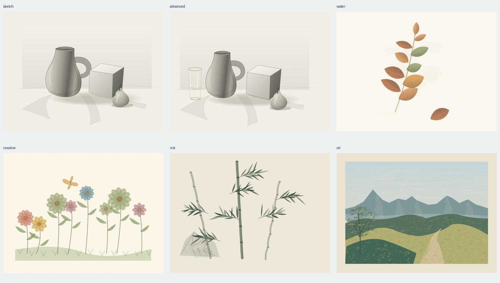
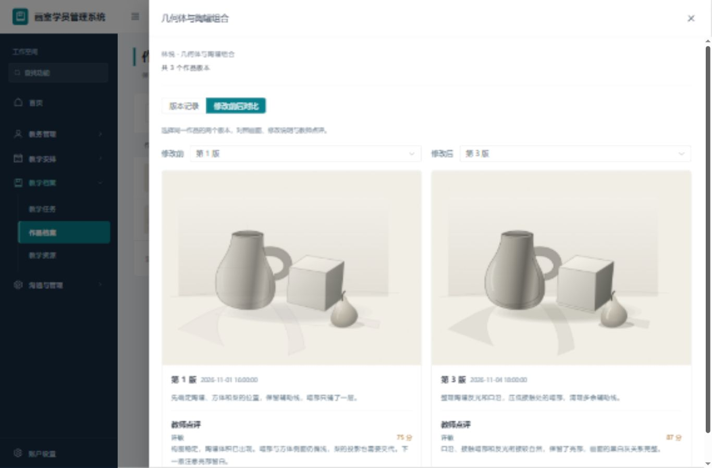

# 界面设计说明

本次调整面向日常教务操作：强化导航、主要按钮与待办事项的识别，保持中文管理系统的表格、筛选和表单习惯。

## 参考来源

参考以下产品的公开介绍页，借鉴品牌色一致性、清晰的信息分组与主次层级，没有复制其后台页面或图片素材：

- [校宝教培](https://www.xiaobaoonline.com/products/erp.html)
- [校宝智慧校园](https://www.xiaobaoonline.com/products/sis.html)
- [ClassIn](https://www.classin.com/)

## 颜色与布局

| 用途 | 颜色 | 使用位置 |
| --- | --- | --- |
| 导航底色 | `#192d43` | 左侧功能导航、登录页说明区 |
| 主色 | `#087f8c` | 主要按钮、选中导航、模块标识 |
| 提醒色 | `#bf791f` | 待办事项、需要关注的数量 |
| 页面底色 | `#f2f5f7` | 内容区域底色 |

首页优先显示统计与常用入口，随后展示近期课程、待办、通知、作品动态及学习概况。统计来源、角色范围和业务口径保持原样。列表页统一标题标识、筛选区分隔、表头背景和状态标签；登录页采用相同的深蓝和青绿配色。

首页最多显示四份最近更新的作品，预览最新版本，展示学员、班级、版本及点评数量。使用现有带权限校验的作品和文件接口获取访问地址，兼容本地文件与私有 OSS；图片失败或附件不是图片时显示占位内容，不阻塞首页其他模块。

作品列表补充最新版本缩略图；作品详情提供“版本记录”和“修改前后对比”两种视图。对比可选择较早和较晚的版本，左右同时展示图片、修改说明和教师点评。窄屏下两列按顺序纵向排列。

窄屏桌面和手机使用两列统计；手机侧栏采用抽屉导航，首页课程切换为纵向列表，业务表格保留内部横向滚动。保留键盘焦点、导航标签及系统减少动画设置。

## 本地验证

2026-11-19 在独立开发数据库验证：

- 管理员、学员、监护人登录与首页显示；监护人保留只读提示及绑定学员范围。
- 首页常用入口、学员搜索、重置筛选、编辑弹窗打开与取消、退出登录。
- 管理员四份作品和学员两份作品的图片成功加载。
- 手机首页及导航开关、手机课表内部滚动、窄屏统计卡片布局。
- 前端生产构建、修改内容的空白字符检查通过。

本次界面改动在本地完成。线上服务器及 GitHub 是否同步，以实际发布记录为准。

## 作品展示

