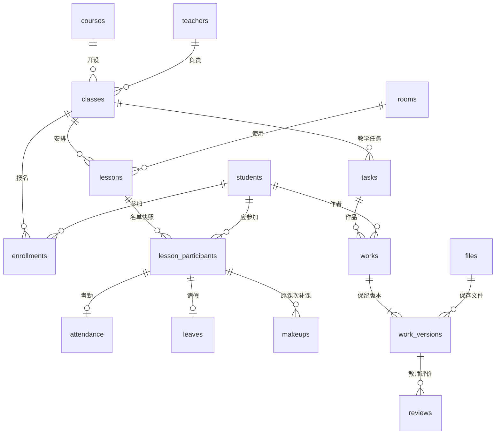

# 系统设计说明

系统按课程、班级和实际课次组织教学，不以订单或视频观看时长代替学习进度。一个 Spring Boot 应用处理业务，MySQL 事务保证关键写入一致性；Vue 项目根据账号权限显示不同页面。

## 实体关系

报名保存生效与结束日期，区间为「生效日期包含当天，结束日期不包含当天」。课次保存当时的学员名单。合法转班取消生效日起尚未开始的原班正常课次名单，并加入新班尚未开始的有效课次，过去的课次和作品保留。

## 学习进度口径

- 应完成：筛选范围内有效正常课次的学员记录数，包含已排未来课次；停课和已取消成员记录不计入。
- 已完成：原课出勤，或者对应补课已出勤完成，每条原课次义务最多计一次。课次开始后可登记出勤，因此该数量可能包含正在上课但尚未结束的课次。
- 请假记录：当前有效考勤状态为请假的原课次；补完课后仍保留请假事实。
- 待补课：当前有效原课次为请假或缺勤，且尚未完成补课；包括已安排但未出勤的补课。
- 出勤率：已结束原课次中已完成量 / 已结束原课次量，最高为 100%；没有已结束原课次时显示 0%。分子和分母均限定为已结束的原课次，正在上课的出勤不会抬高历史出勤率。它包含补课弥补后的完成情况，不等同于“原课现场出勤率”；论文需要明确口径。
- 完成进度：全部已完成量 / 应完成量，首页显示对应百分比；应完成量为 0 时显示 0%。此指标的分母包含已排未来课次，区别于出勤率。学习进度页面保留原始数量，便于核对。

补课属于对原课次义务的弥补，不增加应完成量。统计筛选日期按原课次开始时间，补课完成后的贡献仍归原课次。调课会让课次进入新的日期区间。

## 业务约束

排课重叠判定为：已有开始 < 新结束，且已有结束 > 新开始。相邻两节课首尾衔接不冲突。教师、教室、班级和有关学员任意一项冲突均拒绝保存。

报名、排课、转班、考勤、补课等关键写操作首先在事务中锁定 `schedule_guard` 的唯一行，串行校验并写入；同时以外键、唯一约束兜底。这个粗粒度锁适合单个小画室，解释和验证简单；不以它宣称高并发能力。若将来服务大量门店，应按班级、时间和资源细化锁粒度。

班级容量按报名有效日期区间计算最大同时在读人数，同一学员只计一次。预约转出的学员在结束日前仍占名额，尚未生效的报名从生效日开始占名额，同日转出与转入按结束日期不包含当天合并计算；不会把互不重叠的报名简单累加。新增报名检查其生效日起的峰值，缩减班级容量检查今天及未来的峰值，同时核对已排课次的实际名单容量。班级列表中的学员数按今天的有效报名区间计算。

新报名只加入生效日起尚未开始的课次，不回填已经开始的历史名单。转班生效日不得早于今天或原报名日期；若涉及的原班课次已经开始，或已有出勤、缺勤记录，则要求调整生效日期。已有有效补课关联时先处理补课。若涉及的未来课次只有已批准请假且无有效补课，转班会撤销旧班请假考勤、取消申请并记录审计，再更新班级名单。

考勤按 `participant_id` 唯一。相同状态和备注的重复提交不产生新记录；修改已有状态或备注必须提供更正原因。登记或更正为实际出勤、缺勤后，同步取消该课次学员仍待审批或已批准的请假申请，避免出现与实际考勤矛盾的待办。补课考勤变为出勤时更新关联补课为已完成；更正补课出勤时同步恢复未完成状态并记录日志。已完成补课不能直接取消。

批准请假后生成 LEAVE 考勤以支持提前安排补课。若该课次仅有请假记录，可以调课，旧请假及其考勤会同步撤销，保留申请记录和更正日志，学员按新时间重新申请。已有出勤/缺勤的课次不能直接调课；已有有效补课安排的原课次也要先处理关联补课，避免留下错误关系。

停课同步取消相关名单、待审批或已通过的请假和未完成的补课关联；已有出勤、缺勤或已完成补课的记录均拒绝直接停课抹除。班级结班前要求计划课次与已安排补课处理完毕。

作品首次提交和提交新版本要求学员当前仍在任务所属班级的有效报名区间内，且班级未结班；未生效报名、已转出或已结班只保留历史查看权限。任务设置截止日期时，按北京时间判定，截止当天仍可提交，次日起拒绝新增提交和新版本。具有本班权限的教师或管理员可修改任务标题、说明及截止日期，包括延期后重新开放提交，但不能改变原任务所属班级和关联课次；需要变更归属时新建任务。任务、作品、版本及点评的历史关联保持不变。

## 首页聚合

首页是独立信息总览，展示身份对应的统计、常用入口、近期课程、待办事项、通知公告、作品动态与学习概况。管理员、教师、学员和监护人使用各自授权范围的数据；统计数字和待办均可进入对应业务模块，通知在首页可直接阅读并记录已读。

首页课程只展示接下来最多 6 次未结束且未完成登记的已安排课次，完整记录仍在课表与考勤模块。作品动态按最近更新排序；“尚无点评作品”指该作品所有版本都没有点评，不代表最新版本一定没有点评。“待提交任务”仅统计当前允许提交、尚未提交作品且未过截止日期的任务。监护人只显示绑定学员信息与查看入口。

首页学习概况汇总当前授权范围的应完成、已完成、请假和待补课量，并显示完成进度；出勤率使用已结束原课次口径，不使用全部已完成量除以历史课次数。加载失败会明确提示，不以虚构数量替代真实数据。

## 权限与文件

JWT 的 subject 是用户编号，后端每次查询账号是否启用和 auth_version 是否一致。密码更改、管理员修改授权、退出会更新 auth_version，旧会话随即失效。BCrypt 保存密码散列。

管理员管理全部数据。教师按任教班级和课次约束业务数据；学员按 studentId 约束自己的作品、请假、课表和进度；监护人采用绑定指定 studentId 的只读账号，后端拦截业务写入。

文件先上传，再关联作品版本或班级资源。未关联的文件只有上传者与管理员可读取。关联后按作品作者/绑定监护人/任课教师或资源班级范围鉴权。文件 ID 可猜到不代表有读取权限。下载链接只短时有效；本地文件读取还会重新检查账号和业务权限，OSS 使用短时预签名 URL。

## 适合阅读代码的顺序

1. `auth/AuthController` 与 `AuthService`：理解登录请求、BCrypt 和 JWT。
2. `config/WebConfig` 与 `common/Actor`：理解拦截器与 ThreadLocal。
3. `catalog/CatalogController` 与 `CatalogService`：跟踪一个学员新增和查询。
4. `business/EnrollmentService`：理解报名容量、转班与事务。
5. `business/ScheduleService`：理解时间冲突、名单快照和考勤。
6. `business/LeaveMakeupService` 与 `StatisticsService`：解释补课不会重复统计。
7. `business/LearningService` 与 `files/FileService`：解释作品版本、点评及文件权限。
8. 前端 `Dashboard.vue` 汇总角色首页，`pages.js` 定义字段和菜单，`ResourcePage.vue` 复用管理表格和业务弹窗，`Fields.vue` 负责输入与上传。

## 论文内容建议

按需求分析、总体设计、数据库设计、详细实现、测试和总结组织。关键实现写真实代码中的排课判定、事务锁、唯一约束、数据范围、补课状态与作品版本，不把没用的 Nacos、消息队列、Elasticsearch 写成已实现技术。Redis 仅在启用时用于登录限流，OSS 仅在完成云端配置和验证后写成已部署。

截图可以使用系统中的虚构演示数据；测试表记录输入、预期、实际结果及缺陷修复。浏览器兼容性、服务器性能和 OSS 联通要写实际测过的环境，避免用开发机结果推断公网高并发能力。
